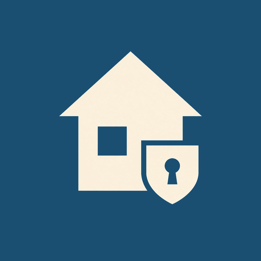
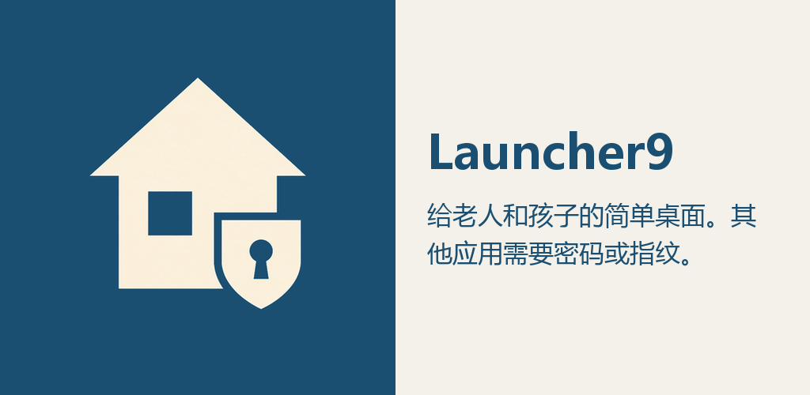

# Launcher9

给老人和孩子用的简单桌面。主屏上只留下你点头的应用，其余应用要密码或指纹才能打开。

[English](#english)

  

  

## 为什么用它

手机上的应用越来越多，老人容易点错，孩子也容易打开不该开的东西。Launcher9 把桌面收成短短一列：电话、信息、联系人、浏览器和设置会先放好，别的应用默认不出现。

没放在主屏上的应用如果自己跑到前台，会被拦住，并要求输入密码。紧急呼叫仍然可以拨打。

## 能做什么

- 主屏只显示已添加的应用，图标大、字清楚，只支持竖屏
- 添加应用、打开全部应用、更换壁纸和进入使用控制时，需要 4 到 6 位密码
- 设备有指纹时，可以用指纹代替密码
- 未添加到主屏的应用进入前台时弹出拦截页，验证通过只放行这一次
- 主屏提供电话、相机和紧急呼叫入口
- 界面提供中文和英文

## 开始使用

1. 安装后把 Launcher9 设为默认桌面，按主页键才会回到这里。
2. 设置使用控制密码。有指纹的话可以一并打开。
3. 开启「使用情况访问」，用来判断当前前台是哪个应用。
4. 开启「显示在其他应用上层」，拦截页会马上盖住画面。

需要 Android 6.0 及以上。

## English

Launcher9 is a simple home screen for seniors and kids. The home screen shows only the apps you allow. Everything else asks for a PIN or fingerprint.

Phone, Messages, Contacts, Browser, and Settings are placed on the home screen first. If another app comes to the foreground, Launcher9 blocks it until the PIN is entered. Emergency calling stays available.

- Portrait home screen with a short list of approved apps
- A 4–6 digit PIN for adding apps, All Apps, wallpaper, and Usage Control
- Fingerprint instead of the PIN when the device has one
- A block screen when an app that is not on the home screen comes forward
- Phone, camera, and emergency-call shortcuts
- Chinese and English

Set Launcher9 as the default home app, then turn on usage access and display over other apps. Android 6.0 or later.
